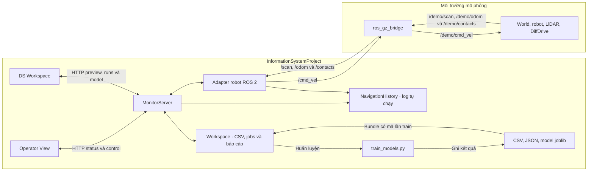

# Kiến trúc và mô tả mã nguồn Navigation Monitor

Tài liệu dành cho ba thành viên phát triển app và mô phỏng robot. App hiện dùng được với CSV mẫu của Hiển hoặc với robot/world demo ROS 2 trong repo. Robot, map và dữ liệu dùng để nghiệm thu bài toán đi tới đích sẽ được tích hợp sau. Các việc cần làm và tiêu chí nghiệm thu nằm trong [kế hoạch triển khai](IMPLEMENTATION_PLAN.md).

## 1. Ranh giới hệ thống

Đề tài dùng phân loại có giám sát để chọn hành động rời rạc ở mỗi chu kỳ. Người vận hành lái robot để tạo nhãn, Data Scientist huấn luyện và chọn model, sau đó Operator chạy thí nghiệm và quan sát kết quả trong môi trường mô phỏng.

| Phần | Thành phần | Vai trò trong nhóm |
| --- | --- | --- |
| App web | Một trang Navigation Monitor, hai tab **Operator View** và **DS Workspace** | Hoàng phụ trách vận hành và kết nối. Đạt phụ trách luồng dữ liệu, huấn luyện và đánh giá trên web. |
| Backend app | Python HTTP, quản lý dataset và lần train, nạp model vào runtime | Cùng phục vụ hai tab. Phần huấn luyện chạy độc lập với ROS. |
| Adapter robot | Node Python ROS 2 đọc LiDAR/odometry, chạy suy luận và xuất lệnh vận tốc | Hoàng tích hợp với simulator của Hiển. |
| Simulator | Gazebo chạy robot, động lực học, cảm biến, bản đồ và các tình huống thử nghiệm | Hiển bàn giao world, robot, cách chạy, cấu hình cảm biến và thông tin va chạm. |



Ranh giới phía app là `MonitorServer(address, robot, workspace)`. Adapter cung cấp `adapter`, `map`, `status()`, `manual_csv()`, `control(request)` và `select_model(run_id, model, bundle)`. Adapter có đích cung cấp thêm `goal` với `x`, `y`, `radius` tính bằng mét. `Monitor` triển khai các phương thức này bằng ROS 2. `OfflineRobot` cung cấp trạng thái tối thiểu để mở DS Workspace, đánh dấu model đã chọn trong phiên app và báo rằng robot chưa kết nối. Khi đổi simulator hoặc phiên bản ROS, giữ hợp đồng HTTP và triển khai lại phần adapter tương ứng. Nếu bộ đặc trưng thay đổi, cập nhật đồng bộ code thu mẫu, trainer, bundle và code suy luận.

### Các chế độ chạy

| Chế độ | Điểm vào | Nguồn dữ liệu và mức triển khai |
| --- | --- | --- |
| Mockup HTML | `Navigation Monitor.html` mở từ máy chủ tĩnh, hoặc nút `Mockup` | `App` trong `app.jsx` và `Sim` trong `sim.jsx` chạy mô phỏng trình duyệt. Dữ liệu, điểm model, expert/thông tin giải thích và thao tác trong mockup phục vụ minh họa. |
| DS Workspace local | `python ros_gazebo_demo/monitor_http.py` | HTTP thật, CSV thật, scikit-learn thật và artifact được lưu trên máy. Trang chủ mở `?live=1#ds`. Tab Operator báo chưa có robot. |
| Demo tích hợp | Docker hoặc `demo.launch.py web:=true` trong môi trường ROS 2 | Cùng giao diện và HTTP backend, dùng adapter live với robot/world demo. Trang chủ mở Operator View, chuyển tab DS trong cùng app. |

Tham số `live=1` chọn `LiveApp`, hash `#ds` mở tab DS. React, ReactDOM và Babel được tải từ CDN theo cấu hình HTML. Python dùng `ThreadingHTTPServer`, còn huấn luyện dùng NumPy, scikit-learn và joblib. Lệnh cài đặt, chạy local, Docker và smoke test có trong [README của demo](../ros_gazebo_demo/README.md).

## 2. Mã nguồn và điểm sửa

### App và giao diện

| Tệp | Nội dung | Sửa khi |
| --- | --- | --- |
| [Navigation Monitor.html](<../Navigation Monitor.html>) | Thẻ `#root`, thứ tự nạp React/Babel, script JSX và CSS | Thêm asset hay thay điểm vào. |
| [app.jsx](../app.jsx) | Chọn `App` mockup hoặc `LiveApp`. `App` quản lý vòng mô phỏng, lệnh console, panel và export của mockup | Chỉnh hành vi minh họa hoặc cách chuyển chế độ. |
| [live.jsx](../live.jsx) | `liveRequest()` gọi HTTP. `LiveApp` tải setup, polling trạng thái, duy trì tab và hiển thị lỗi. `LiveRobot` dựng màn hình Operator | Chỉnh điều khiển, telemetry, bản đồ, trạng thái kết nối hoặc nội dung tab Operator. |
| [ds-workspace.jsx](../ds-workspace.jsx) | `DatasetPanel` xem trước dữ liệu và khởi chạy train. `LiveDataScience` quản lý lần train, model đang xem và thao tác chọn model. `ModelEvaluation` dựng confusion matrix và chi tiết lỗi | Chỉnh luồng DS, chỉ số, bảng, export hoặc truy vết mẫu sai. |
| [components.jsx](../components.jsx), [icons.jsx](../icons.jsx), [styles.css](../styles.css) | Panel, trạng thái, map/radar dùng lại giữa các chế độ, các panel phong phú của mockup, icon và theme | Chỉnh hình thức hoặc nối một panel mockup với dữ liệu live thật. |
| [sim.jsx](../sim.jsx), [samples.jsx](../samples.jsx) | Robot/rule giả lập trên web, warehouse minh họa và snapshot dùng cho trang thuyết minh | Chỉnh dữ liệu và hành vi minh họa. |
| [breakdown.jsx](../breakdown.jsx), [breakdown-en.jsx](../breakdown-en.jsx), [shots.jsx](../shots.jsx), [screens/](../screens/) | Trang thuyết minh VI/EN, dựng ảnh chụp và ảnh của mockup | Đồng bộ slide, breakdown hoặc ảnh sau khi giao diện live được cập nhật. |

### Backend, ML và simulator

| Tệp | Thành phần chính | Trách nhiệm |
| --- | --- | --- |
| [monitor_http.py](../ros_gazebo_demo/monitor_http.py) | `MonitorServer`, `MonitorRequest`, `OfflineRobot` | Phục vụ file web, nhận JSON, định tuyến API, chuyển yêu cầu robot đến adapter, trả báo cáo và ảnh chụp CSV theo lần train. |
| [ds_workspace.py](../ros_gazebo_demo/ds_workspace.py) | `preview_dataset()`, `Workspace` | Chọn nguồn CSV, kiểm tra và xem trước, quản lý job, đọc hiện vật, truy vết dự đoán sai và nạp bundle tương thích. |
| [navigation_history.py](../ros_gazebo_demo/navigation_history.py) | `NavigationHistory` | Ghi lượt lái tay và tự chạy đã kết thúc vào JSON, trả lịch sử và xuất CSV toàn bộ lượt. |
| [inputs/train_models.py](../ros_gazebo_demo/inputs/train_models.py) | `read_csv()`, `prepare_dataset()`, `train_models()` | Logic train/test dùng chung giữa CLI và web. Cả hai đường dùng cùng cách chuẩn bị dữ liệu. |
| [inputs/lidar_features.py](../ros_gazebo_demo/inputs/lidar_features.py) | `extract_features()` và hằng số vùng quét | Biến `LaserScan` thành năm khoảng cách nhỏ nhất. Hàm được dùng trực tiếp trong runtime ROS 2. |
| [prepare_models.py](../ros_gazebo_demo/prepare_models.py) | `prepare()` | Tạo bộ tham chiếu từ CSV 644 mẫu. Docker thực hiện lúc build, chế độ local thực hiện lần đầu khi thư mục tham chiếu chưa tồn tại. |
| [web_bridge.py](../ros_gazebo_demo/web_bridge.py) | `Monitor`, `arena_map()` | Sub/publish ROS 2, giữ trạng thái và model đang dùng, suy luận, ghi mẫu lái tay và cung cấp hình học map từ SDF demo. |
| [demo.sdf](../ros_gazebo_demo/demo.sdf), [bridge.yaml](../ros_gazebo_demo/bridge.yaml) | World `integration_demo`, robot `demo_robot`, DiffDrive, cấu hình ánh xạ topic | Cung cấp simulator tạm và đường truyền dữ liệu Gazebo–ROS 2. |
| [demo.launch.py](../ros_gazebo_demo/demo.launch.py), [Dockerfile](../ros_gazebo_demo/Dockerfile), [smoke_test.py](../ros_gazebo_demo/smoke_test.py) | Launch simulator/bridge/web, đóng gói thư viện, kiểm tra ba topic | Chạy cùng môi trường và kiểm chứng LiDAR, chuyển động qua odometry, lệnh tiến và dừng. |

Bộ mẫu ngoài repo nằm trong `robot_ml.zip` và thư mục `robot_ml/`. `collect_data.py` và `run_robot.py` thuộc nguyên mẫu Noetic của Hiển. Log KNN/Decision Tree và model cũ giúp đối chiếu dữ liệu, còn app tạo bundle trong môi trường của nó để khớp scikit-learn. ZIP có script, dataset, log và kết quả ML. Robot, world, mesh và launch dùng cho bản bàn giao chính thức cần lấy từ Hiển.

## 3. API giữa trình duyệt và backend

Các URL cùng origin với web. `LiveApp` tải `setup` khi kết nối, rồi gọi `status` khoảng mỗi 200 ms sau khi request trước hoàn tất. Tab DS lấy danh sách job khoảng mỗi giây và lấy chi tiết khi đổi lần train. Vòng điều khiển nằm ở backend nên vẫn chạy khi đổi tab hoặc đóng trang quan sát.

| Method và URL | Payload hoặc dữ liệu trả về | Dùng ở đâu |
| --- | --- | --- |
| `GET /api/setup` | `map`, `goal`, tên adapter, góc tâm các vùng LiDAR, nửa độ rộng vùng, báo cáo tham chiếu | Khởi tạo cả hai tab. |
| `GET /api/status` | `ready`, `mode`, `reason`, `pose`, `goal` đang chọn, `goal_distance`, `goal_angle`, `goal_reached`, `sectors`, `prediction`, `command`, `active_run`, `active_model`, `elapsed`, `traveled`, `trail`, `recorded`, `contact_connected`, mã và trạng thái lượt điều hướng gần nhất | Trạng thái và telemetry live. Chế độ offline trả tập con phù hợp. |
| `POST /api/control` | `start_manual` bắt đầu lượt lái tay, `start` bắt đầu lượt tự chạy, `manual` gửi `action`, `set_goal` nhận `x`/`y`, `stop` kết thúc lượt, `reset` reset cả phiên, `model` nhận `run_id` và `model` | Trả snapshot sau thao tác. Reset trả trạng thái đang xử lý khi đợi Gazebo hoàn tất. |
| `GET /api/dataset/reference.csv`, `GET /api/dataset/manual.csv` | File CSV tham chiếu hoặc CSV lái tay hiện có | Tải dữ liệu gốc. |
| `GET /api/dataset/sessions`, `GET /api/dataset/sessions/{id}.csv` | Các phiên lái tay lưu lúc reset và CSV của phiên được chọn | Mở lại phiên cũ để xem trước, tải xuống hoặc train. |
| `GET /api/navigation/runs`, `GET /api/navigation/runs.csv` | Tối đa 20 lượt gần nhất dưới dạng JSON, hoặc toàn bộ kết quả dưới dạng CSV. Query `session` lọc theo phiên | Xem kết quả từng lượt và lấy số liệu đánh giá điều hướng. |
| `POST /api/ds/preview` | `source: reference / manual / upload`. Upload gửi thêm `name` và nội dung `csv` UTF-8 trong JSON | Xem số lượng, mẫu đầu, phân bố nhãn và kiểm tra có train được. |
| `POST /api/ds/runs` | Cùng kiểu dữ liệu với preview, phản hồi HTTP 202 chứa mã lần train | Xếp một job huấn luyện từ ảnh chụp dữ liệu tại thời điểm gửi. |
| `GET /api/ds/runs`, `GET /api/ds/runs/{id}` | Lịch sử cùng trạng thái job gần nhất, hoặc báo cáo chi tiết về model/split của một lần train | Theo dõi job và chọn kết quả đánh giá. Mã `reference` chỉ bộ dựng sẵn. |
| `GET /api/ds/runs/{id}/mistakes?model=...&actual=...&predicted=...` | Tổng số lỗi và tối đa 50 mẫu trong một ô ngoài đường chéo, kèm dòng CSV, thời điểm và đặc trưng | Soi mẫu dự đoán sai. |
| `GET /api/ds/runs/{id}/dataset.csv` | Bản CSV dùng đúng trong lần train được chọn | Tải dữ liệu để tái lập kết quả. |

Ví dụ chọn Random Forest đã train. Thay mã minh họa bằng `id` trả về từ API train.

```json
{
  "command": "model",
  "run_id": "20261119_084325_57d018",
  "model": "random_forest"
}
```

Preview có thể trả HTTP 200 để giao diện vẫn hiển thị thống kê cùng trường `error` đối với CSV có cấu trúc đọc được nhưng chưa đạt yêu cầu. Payload sai trả 400, lần train hoặc model không tìm thấy trả 404, train khi có job đang chạy hoặc đổi model khi robot đang chạy trả 409. Server từ chối POST cross-origin từ trình duyệt. CSV upload hiện giới hạn 4 MiB.

## 4. Operator View và vòng điều khiển

### Các panel live hiện tại

| Panel | Nguồn dữ liệu | Hành vi |
| --- | --- | --- |
| Robot Control | `ready`, `mode`, `reason`, model và mã lần train | `Start manual` mở các nút lái tay và W/A/D/S. `Start autonomous` dùng model đang active. `End run` kết thúc lượt. |
| Robot Action | `prediction` và `command` | Hiện riêng dự đoán cuối và lệnh thực tế. Hai giá trị có thể khác khi runtime chặn lệnh tiến. |
| Robot Telemetry | `pose` từ `/odom` và `traveled` | Hiện X, Y, hướng, vận tốc tịnh tiến/đổi hướng đo được và quãng đường. Trail và quãng đường trên UI bắt đầu lại khi mở lượt mới. |
| Gazebo Arena | Biên sàn, vật cản từ `arena_map()`, pose và trail từ odometry, `status.goal` | Vẽ top view, robot, đường đi và đích. Khi bật `Pick on map`, chuyển điểm bấm từ SVG sang tọa độ arena rồi cộng origin để gửi `set_goal` theo frame odometry. |
| Goal | `goal`, `goal_distance`, `goal_angle` | Hiện khoảng cách và góc lệch. Đổi đích giữa hai lượt bằng cách bấm bản đồ hoặc nhập X/Y. Backend kiểm tra vòng đích trong arena và cách vật cản. |
| LiDAR | `sectors` và `range_max` từ scan | Vẽ radar năm vùng. Kích thước khai báo theo scan và góc chia từ setup. |
| Navigation Runs | Lịch sử `runs/navigation/` | Mở cả lượt lái tay và tự chạy cùng đích, lý do kết thúc, va chạm, quãng đường, thời gian và độ trễ inference nếu có. Xuất CSV. |

### Luồng dữ liệu và quyết định

Trong map demo, `setup.map` có `name`, `min_x`, `min_y`, `w`, `h` và `obstacles`. Mỗi vật cản là `[x, y, width, height]` tính từ origin dưới trái của sàn. `LiveRobot` trừ `min_x/min_y` khỏi pose và trail, sau đó `MapPanel` đảo trục Y khi vẽ lên SVG. Phép tịnh tiến này dựa vào việc odometry và world demo có cùng hướng trục.

1. `receive_scan()` lưu năm khoảng cách, timestamp ROS và thời điểm nhận theo đồng hồ monotonic. `receive_odom()` lấy X/Y, tính yaw từ quaternion, lấy `v/w` trong twist, giữ trail tối đa 400 điểm và chỉ cộng quãng đường khi dịch chuyển ít nhất 0,015 m.
2. Runtime đặt timer 0,1 s, tương đương khoảng 10 Hz theo nhịp timer. `ready()` yêu cầu scan và odometry mới trong 0,8 s, đủ năm khoảng cách và có subscriber cho `/cmd_vel`.
3. `start_manual` mở lượt lái tay tới đích hiện tại. Mỗi lệnh kéo dài tối đa 0,55 s và có thể gia hạn. Nhịp hết hạn gửi vận tốc 0 và chờ thao tác kế tiếp trong cùng lượt. Khi bắt đầu nhịp mới hoặc đổi hành động, adapter lấy chín feature từ scan/odom lệch tối đa 0,20 s trước khi phát lệnh. Gia hạn cùng hành động trong một nhịp giữ nguyên mẫu đã thu.
4. Trong `auto`, runtime chọn vector 5 hoặc 9 feature theo bundle active, rồi gọi `model.predict([features])` và phát `Twist` lên `/cmd_vel`. Với vector 9 feature, runtime kiểm tra độ lệch timestamp giống lúc thu mẫu. `select_model()` nạp đúng cặp mã lần train và thuật toán khi robot ở `idle`.
5. Cả hai chế độ dùng khoảng cách từ pose thật để phát vận tốc 0 và đánh dấu `reached` khi vào bán kính. Với lượt lái tay, runtime thêm một mẫu `stop` tại đích khi có scan/odom đồng bộ và timestamp mới. Contact, `End run`, mất telemetry hoặc hết thời hạn đều kết thúc lượt. Demo đặt giới hạn 120 s lái tay và 60 s tự chạy. Guard LiDAR 0,38 m hoặc biên arena kết thúc lượt tự chạy và chỉ dừng nhịp tiến trong lượt lái tay.
6. Mỗi lượt có ID, chế độ, pose đầu và đích riêng. Khi kết thúc, `NavigationHistory` lưu một JSON trong volume. Tự chạy ghi thêm độ trễ đo quanh `model.predict()`. Server trở về `idle` với trạng thái `reached` hoặc `terminated`. Có thể đặt đích và bắt đầu lượt khác từ pose hiện tại trong cùng phiên.
7. `Reset session` lưu CSV đang có, gửi reset world và chờ scan/odom thuộc thời điểm mới sau khi thời gian mô phỏng quay về đầu. Khi thành công, server tạo ID phiên mới, xoá trail và trạng thái lượt cuối trên màn hình. Model đã chọn và các lần train vẫn dùng lại được. UI lọc lịch sử theo phiên hiện tại.

Ánh xạ demo dùng `(linear.x, angular.z)` với đơn vị m/s và rad/s.

| Nhãn hoặc lệnh | Twist | Nguồn hiện tại |
| --- | --- | --- |
| `forward` | `(0.30, 0)` | Lái tay hoặc model |
| `left` | `(0, +0.70)` | Lái tay hoặc model |
| `right` | `(0, -0.70)` | Lái tay hoặc model |
| `stop` | `(0, 0)` | Hành động lái tay để ghi nhãn, lệnh dừng khi vào đích hoặc dự đoán của model bốn lớp. Nút End run và các điều kiện kết thúc khác cũng phát vận tốc 0. |

## 5. DS Workspace và pipeline ML

### Trải nghiệm trên web

1. Mở **Labeled Dataset** và chọn **Reference driving session**, **Gazebo manual session** hoặc **Upload a CSV**. Preview dùng tối đa sáu dòng, hiển thị số mẫu theo nhãn và quy mô train/test.
2. **Train models** khởi chạy job. **Training Runs** hiển thị trạng thái `running / completed / failed` và lịch sử. Lần mới hoàn tất được mở để xem kết quả, CSV gắn với lần train có thể tải lại.
3. **Model Comparison** so sánh bốn thuật toán với majority baseline. Chọn một dòng để xem **Confusion Matrix** và **Per-Class Test Scores**. Hàng là nhãn do người lái gán, cột là dự đoán. Bấm ô ngoài đường chéo để mở **Misclassified Test Samples**.
4. **Use …** yêu cầu backend nạp artifact. Model active hiển thị theo cả mã lần train và thuật toán. Majority baseline dùng làm mốc so sánh. Operator View dùng bundle active khi bắt đầu tự chạy.

### Dữ liệu tham chiếu và cách train

```text
session_id,world,scan_time,wall_time,left,front_left,front,front_right,right,linear_velocity,angular_velocity,goal_distance,goal_angle,action,linear_x,angular_z,capture_timing,run_id,goal_x,goal_y,label_source
```

- `scan_time` đến từ header LiDAR, `wall_time` ghi thời gian máy khi ghi dòng. `linear_x` và `angular_z` là lệnh đã gửi. `linear_velocity` (m/s) và `angular_velocity` (rad/s) lấy từ odometry. `goal_distance` tính theo mét, `goal_angle` là góc lệch chuẩn hóa về `[-π, π]`.
- `capture_timing` ghi nguồn gốc cách lấy mẫu. Chỉ số `before_command` cho biết feature được lấy ở trạng thái trước lệnh với nhãn tương ứng. CSV 9 feature thiếu thông tin này được đánh dấu để nhận biết nguy cơ rò rỉ nhãn từ vận tốc đo sau lệnh.
- `run_id` nối mẫu tới log điều hướng. `goal_x` và `goal_y` lưu đích của lượt. `label_source` là `operator` hoặc `goal_reached`. Các cột này giúp truy vết và chia tập. Vector ML vẫn có chín feature.
- Thứ tự vector là `left, front_left, front, front_right, right`, tâm vùng tương ứng `+90°, +45°, 0°, -45°, -90°`, nửa độ rộng `10°`. Giá trị `+inf` của tia được quy về `range_max`. Tia lỗi hoặc ngoài khoảng bị bỏ, vùng rỗng trả `None`. Trainer yêu cầu giá trị hữu hạn, không âm và thời gian tăng nghiêm ngặt. Độ rộng vùng trong PDF minh họa khác code mẫu. Nhóm cần chốt một quy ước cho cả thu dữ liệu, train, suy luận và radar.
- [CSV tham chiếu trong app](../ros_gazebo_demo/inputs/dataset.csv) trùng file `manual_20261118_025829_54af3040.csv` của Hiển. Có **644 mẫu** gồm 323 forward, 169 left và 152 right. File 992 mẫu có tốc độ 0,10 m/s và ±0,50 rad/s, nằm ngoài cấu hình tốc độ của trainer hiện tại.
- Trainer tự nhận schema cũ 5 feature / 3 nhãn hoặc schema live 9 feature / 4 nhãn. Mỗi lần train cần một phiên có ít nhất 50 mẫu, đúng bộ lệnh vận tốc và đủ nhãn của schema. Với `run_id`, trainer lấy ranh giới giữa hai lượt gần mốc 70% mẫu nhất rồi giữ nguyên lượt trong từng tập. CSV cũ dùng mốc 70% theo thời gian, bỏ vùng đệm 2 giây mỗi phía. Bộ tham chiếu có **440 train / 183 test / 21 mẫu vùng đệm**. Cả train và test cần đủ lớp. Đánh giá cuối cần các phiên độc lập.
- `StandardScaler` được fit trong pipeline KNN và Gaussian Naive Bayes bằng tập train. Decision Tree dùng giới hạn độ sâu, class weight và seed cố định. Random Forest dùng 100 cây, độ sâu tối đa 8, tối thiểu 5 mẫu mỗi lá và class weight cân bằng. Baseline chọn lớp có nhiều mẫu nhất trong tập train. Cả năm hàng dùng cùng tập test.
- Worker nhận một ảnh chụp CSV, chạy trainer bằng subprocess trong thư mục tạm và công bố thư mục kết quả sau khi job thành công. Mỗi server nhận một job đang chạy. Live adapter tiếp tục vòng điều khiển trong lúc tạo bundle mới.
- Khi kích hoạt, backend kiểm tra phiên bản scikit-learn, tên và thứ tự đặc trưng, góc chia LiDAR và bảng hành động trước khi dùng estimator trong bundle.

### Lưu trữ và truy vết

| Nơi lưu hoặc file | Ý nghĩa |
| --- | --- |
| `reference/` | CSV và bộ model/báo cáo dựng sẵn. Khi boot, runtime demo chọn KNN tham chiếu. |
| `runs/<run_id>/dataset.csv`, `run.json` | Ảnh chụp CSV và metadata nguồn của lần train mới. |
| `runs/sessions/<session_id>.csv` | Bản CSV phiên lái tay được lưu khi reset. |
| `models/<thuật toán>.joblib` trong mỗi lần train | Estimator đã fit cùng metadata đầu vào, hành động và thư viện. Majority baseline có báo cáo nhưng không tạo bundle điều khiển. |
| `results/manifest.json` | Session, hash của CSV, kích thước split, số mẫu từng nhãn, phiên bản thư viện và giới hạn đánh giá. |
| `results/metrics.csv`, `classification_reports.json`, `*_confusion.csv` | Điểm tổng hợp, điểm theo lớp và ma trận nhầm lẫn trên tập test. |
| `results/test_predictions.csv` | Nhãn thật, dự đoán theo model, thời điểm và dòng nguồn. API mistakes tra các đặc trưng từ CSV đã lưu. |

Local lưu lần train trong `ros_gazebo_demo/runs/`. Docker có thể gắn volume vào `/demo/runs`. CSV lái tay của phiên hiện tại nằm trong bộ nhớ cho tới khi tải xuống hoặc tạo snapshot để train. Mã lần train ML khác mã lượt robot chạy thử. Bản cuối cần lưu cả hai để nối kết quả đi robot với đúng bundle.

## 6. Gazebo demo và bản bàn giao cần tích hợp

### Bản demo trong repo

`demo.sdf` chứa sàn 8 × 8 m có vách bao, ba vật cản và robot hai bánh. LiDAR 360° dùng 360 tia, tần số cấu hình 10 Hz và khoảng đo 0,10–6,0 m. `OdometryPublisher` gửi pose mô phỏng ở 30 Hz qua `/demo/odom`, dùng `odom` và `base_link` cùng hệ tọa độ của arena. DiffDrive phát odometry bánh xe ở `/demo/wheel_odom` để đối chiếu. `demo.launch.py` có thể chạy Gazebo headless hoặc GUI và bật web cùng bridge. Đích mặc định là `(1.10, 0.75)` m trong frame odometry, bán kính `0.20` m. Có thể cấu hình `goal_x`, `goal_y` và `goal_radius` khi launch.

| Dữ liệu | Topic Gazebo demo | Topic ROS 2 và kiểu | Hướng |
| --- | --- | --- | --- |
| Tia LiDAR | `/demo/scan` | `/scan` · `sensor_msgs/msg/LaserScan`, QoS cảm biến | Gazebo → adapter |
| Pose và vận tốc đo | `/demo/odom` | `/odom` · `nav_msgs/msg/Odometry` | Gazebo → adapter |
| Lệnh vận tốc | `/demo/cmd_vel` | `/cmd_vel` · `geometry_msgs/msg/Twist` | Adapter → Gazebo |
| Contact vật cản | `/demo/contacts` | `/contacts` · `ros_gz_interfaces/msg/Contacts` | Gazebo → adapter |

Kiểm thử bản demo đã xác nhận 360 tia, robot tiến 0,158 m theo odometry và dừng sau lệnh vận tốc 0. Kiểm thử qua HTTP cũng xác nhận thu CSV bằng điều khiển lái tay, train, kích hoạt Random Forest, chạy suy luận tự động rồi dừng. Phép thử đặt robot chạm hai vật cản đã xác nhận đường truyền contact vật lý, dừng lượt và xuất log. Lịch sử giữ được qua lần chạy mới dùng cùng volume. Kết quả điều hướng trên world chính thức cần được đo riêng.

### Đầu vào nhóm cần nhận từ Hiển

| Bàn giao | Nội dung cần có | Chỗ ráp vào app |
| --- | --- | --- |
| World và robot | File world/SDF, robot SDF hoặc URDF/Xacro, mesh/texture và plugin, lệnh launch/reset; phiên bản Gazebo/ROS và cách cài phụ thuộc | Đổi world được launch, cấu hình model/cảm biến và bridge theo stack đã chốt. |
| Điều khiển và cảm biến | Tên topic, chiều/kiểu message, QoS tương ứng nếu dùng ROS 2, tần số, frame và dấu trục. X hướng tiến, Y hướng trái trong robot là quy ước hàm LiDAR đang dùng | Kiểm tra `/scan`, `/odom`, `/cmd_vel` và phép xoay frame LiDAR nếu cảm biến lắp lệch. |
| Bản đồ và đích | Kích thước, origin và hướng trong frame thống nhất, polygon/hộp vật cản, spawn pose, goal và bán kính tới đích theo kịch bản | Thay phần `arena_map()` cố định. Cấp dữ liệu map cho Operator View và dùng cùng frame để tính goal. |
| Phát hiện va chạm | Contact sensor hoặc nguồn sự kiện tương đương, cách loại tiếp xúc bình thường với sàn | Kết thúc/log đúng lý do và đo collision rate độc lập với guard LiDAR. |
| Kịch bản đo | Cùng world, spawn/goal, điều kiện reset, cấu hình lệnh và mã phiên để dựng lại thí nghiệm | So sánh các model trên cùng điều kiện, rồi tập hợp lịch sử điều hướng ở DS Workspace. |

Nếu dùng **ROS 2 Jazzy + Gazebo Harmonic**, cập nhật topic Gazebo trong `bridge.yaml` và giữ tên/kiểu ROS 2 mà adapter đọc. Nếu world của Hiển tiếp tục dùng **ROS 1 Noetic + Gazebo Classic 11**, triển khai adapter đọc/publish bằng `rospy` và theo hợp đồng `MonitorServer`. Cấu hình `ros_gz_bridge` hiện tại xử lý đường Gazebo Harmonic ↔ ROS 2. Hai hướng cần cùng kiểm tra dấu vận tốc, frame, timestamp và kịch bản reset.

### Feature đi tới đích và hoàn thiện thí nghiệm

- **Đồng bộ dữ liệu.** Với vị trí robot `(x, y)`, hướng `yaw` và đích `(gx, gy)` trong cùng frame, tính `dx = gx - x`, `dy = gy - y`, `goal_distance = hypot(dx, dy)` và `goal_angle = normalize(atan2(dy, dx) - yaw)` về `[-π, π]`. Ghi vận tốc đo từ odometry đủ gần thời điểm scan, giữ riêng lệnh thật đã gửi.
- **Đồng bộ schema.** Collector, trainer, bundle và inference dùng cùng thứ tự LiDAR, vận tốc và feature đích. Mẫu `STOP` đến từ thao tác lái tay hoặc lúc lượt lái tay vào đích với telemetry hợp lệ. Nút End run, timeout và robot rảnh có trạng thái riêng.
- **Đồng bộ thí nghiệm.** Log giữ model, mã lần train, world/spawn/goal, trạng thái kết thúc, thời gian, quãng đường, độ trễ suy luận và contact. Với world chính thức, xác nhận tên robot, cặp collider và topic contact trước khi lấy số liệu. Khi publisher ROS contact chưa kết nối, lưu trạng thái va chạm chưa xác định.
- **Cập nhật giao diện.** Operator View đã có lịch sử kết thúc theo lượt. Phần tiến độ và cycle log theo mockup cần nối thêm. DS Workspace dùng dữ liệu trên tập test cho đánh giá phân loại. File log điều hướng cung cấp đầu vào để so sánh model trên cùng kịch bản. Nếu triển khai live accuracy/A-B theo mockup, cần có nhãn tham chiếu đồng bộ từng chu kỳ. Shadow B dự đoán trên cùng input, quyền phát lệnh thuộc model A.

## 7. Tài liệu đối chiếu

Các nguồn đặc tả và trao đổi hiện nằm cạnh repo trong workspace môn học.

- [Đặc tả dự án, FR-01 đến FR-17 và UC-01 đến UC-09](../../docs/project_specification_submission.md)
- [Mockup tiếng Anh, 9 trang](<../../docs/Navigation_Monitor_Mockup_EN 3.pdf>)
- [Sơ đồ luồng nhóm](<../../trao đổi zalo/6.png>) và [phân công DS Workspace](<../../trao đổi zalo/7.png>)
- [Kế hoạch và tiêu chí nghiệm thu của nhóm](IMPLEMENTATION_PLAN.md)
